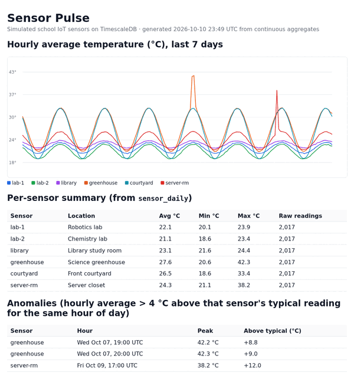

# Sensor Pulse: simulated school IoT sensors on Tiger Cloud (TimescaleDB)

A small time-series project for **MLH Global Hack Week: Hacktoberfest (Oct 2026)**. It covers three Tiger Data challenges in one repo:

| GHW challenge | Where it lives |
|---|---|
| Set up a Tiger Cloud service and create your first **Hypertable** | `sql/01_schema.sql` |
| **Simulate an IoT sensor dataset** with Tiger Cloud | `sql/02_simulate.sql` |
| Accelerate Dashboards with **Continuous Aggregates** | `sql/03_continuous_aggregates.sql`, `dashboard.py` |



## What it does

1. **Hypertable.** `sensor_data` is created with `WITH (tsdb.hypertable, tsdb.segmentby = 'sensor_id', tsdb.orderby = 'time DESC', tsdb.chunk_interval = '1 day')`, so TimescaleDB splits it into one chunk per day. A normal `sensors` table holds metadata (name, type, location) and is joined in queries.
2. **IoT simulation.** Six sensors around a school (robotics lab, chemistry lab, library, greenhouse, courtyard, server closet) report temperature, humidity and CPU load every 5 minutes for 7 days: 12,102 rows made with `generate_series`. Instead of plain `random()`, each sensor follows a daily sine curve (warmest around 3 PM US Central) plus noise, and two incidents are injected: a greenhouse vent left shut and a server-closet AC failure.
3. **Continuous aggregates.** `sensor_hourly` pre-computes hourly avg/min/max temperature, average humidity, peak CPU and reading counts. `sensor_daily` is a **hierarchical** CAGG built on top of the hourly one. Both get refresh policies (every 30 min and every hour), so new data rolls up automatically in the background.
4. **Queries** (`sql/04_queries.sql`): chunk count, latest reading per sensor (`DISTINCT ON`), 30-minute buckets with `last()`, a daily summary, an **anomaly finder** that flags any hour running more than 4 °C above that sensor's typical (median) reading for the same hour of day, an `EXPLAIN ANALYZE` comparing the raw table with the CAGG, and the list of background refresh jobs.
5. **Dashboard** (`dashboard.py`): reads *only* the continuous aggregates and writes a static `dashboard.html` with an inline-SVG chart, a per-sensor summary and the anomaly table. No JavaScript libraries.

## Results from a test run

From `sample-output.txt` (local test, see "How it was tested" below):

- `sensor_data` became a hypertable with **8 chunks** holding **12,102 rows**.
- The anomaly finder caught **exactly the two injected incidents**: the greenhouse at +8.8 / +9.0 °C for two hours, and the server closet at +12.0 °C for one hour. No false positives.
- Same question ("hourly average per sensor"), two ways: the raw hypertable took **~3.5 ms** to aggregate 12,102 rows; the continuous aggregate returned the 1,014 pre-computed rows in **~0.2 ms**. That's tiny either way at this size. The gap is what grows as raw data piles up.

## Run it on Tiger Cloud

1. In [Tiger Console](https://console.cloud.tigerdata.com), create a service and copy its connection string (`postgres://tsdbadmin:...@<id>.tsdb.cloud.timescale.com:<port>/tsdb?sslmode=require`).
2. Either paste the four SQL files, in order, into the Console's SQL editor (`04_queries.sql` uses `\echo`, which is psql-only; skip those lines in the web editor), **or** from a terminal with `psql` installed:

   ```bash
   export DATABASE_URL="postgres://tsdbadmin:<password>@<host>:<port>/tsdb?sslmode=require"
   ./run.sh
   ```
3. Build the dashboard:

   ```bash
   pip install -r requirements.txt
   python dashboard.py      # writes dashboard.html
   ```

`01_schema.sql` drops and recreates only the demo objects (`sensors`, `sensor_data`, `sensor_hourly`, `sensor_daily`), so it's safe to re-run.

## How it was tested

Everything here was run end to end against **self-hosted TimescaleDB 2.30.2 on PostgreSQL 16.15**, built from source in a Linux sandbox. `sample-output.txt` and `dashboard-preview.png` come from that run. It uses the same SQL syntax the Tiger Cloud docs use (`CREATE TABLE ... WITH (tsdb.hypertable)`). It had **not yet been run on a Tiger Cloud service** when this README was written, so run `./run.sh` there and add your own Console screenshot.

Note: `sample-output.txt` shows times in UTC.

## Built with AI assistance

Honest disclosure: this project was built with AI assistance. An AI assistant (Hark) wrote the SQL, the Python dashboard and this README and ran the local tests on behalf of Aariv Patel (GitHub: draarivpatel-ui) for his GHW Hacktoberfest participation. The schema and queries follow Tiger Data's tutorials:
- [Your first hypertable](https://www.tigerdata.com/docs/build/how-to/your-first-hypertable)
- [Simulate an IoT sensor dataset](https://www.tigerdata.com/docs/build/examples/simulate-iot-sensor-data)
- [Continuous aggregates](https://www.tigerdata.com/docs/learn/continuous-aggregates)

## Files

```
sql/01_schema.sql                 sensors table + sensor_data hypertable
sql/02_simulate.sql               7 days of realistic simulated readings + 2 injected incidents
sql/03_continuous_aggregates.sql  hourly + hierarchical daily CAGGs with refresh policies
sql/04_queries.sql                demo / analysis queries
run.sh                            runs all four files against $DATABASE_URL
dashboard.py                      static HTML dashboard from the CAGGs
sample-output.txt                 output of ./run.sh from the local test
dashboard.html / dashboard-preview.png   generated dashboard from the local test
```

License: MIT
