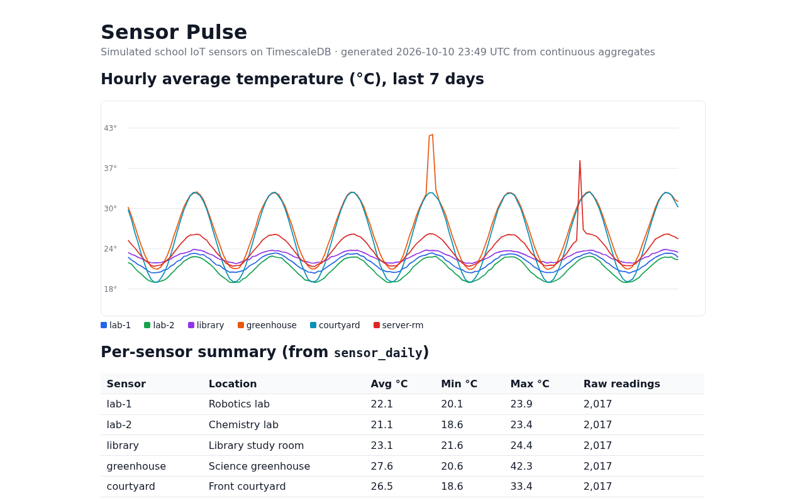

# Sensor Pulse: simulated school IoT sensors on Tiger Cloud (TimescaleDB)

**Live link:** https://github.com/draarivpatel-ui/tiger-sense-pulse (no hosted web app: this is a database project. It runs on your own Tiger Cloud service with `./run.sh`, and `dashboard.html` is a static page it generates.)

**One line:** six simulated school sensors stream into a TimescaleDB hypertable on Tiger Cloud, continuous aggregates roll them up hourly and daily, and an anomaly query catches the two incidents hidden in the data.



*The generated `dashboard.html`, rendered with headless Chromium (Oct 2026).*

A small time-series project for **MLH Global Hack Week: Hacktoberfest (Oct 2026)**. It covers three Tiger Data challenges in one repo:

| GHW challenge | Where it lives |
|---|---|
| Set up a Tiger Cloud service and create your first **Hypertable** | `sql/01_schema.sql` |
| **Simulate an IoT sensor dataset** with Tiger Cloud | `sql/02_simulate.sql` |
| Accelerate Dashboards with **Continuous Aggregates** | `sql/03_continuous_aggregates.sql`, `dashboard.py` |

## Features

1. **Hypertable.** `sensor_data` is created with `WITH (tsdb.hypertable, tsdb.segmentby = 'sensor_id', tsdb.orderby = 'time DESC', tsdb.chunk_interval = '1 day')`, so TimescaleDB splits it into one chunk per day. A normal `sensors` table holds metadata (name, type, location) and is joined in queries.
2. **IoT simulation.** Six sensors around a school (robotics lab, chemistry lab, library, greenhouse, courtyard, server closet) report temperature, humidity and CPU load every 5 minutes for 7 days: 12,102 rows made with `generate_series`. Instead of plain `random()`, each sensor follows a daily sine curve (warmest around 3 PM US Central) plus noise, and two incidents are injected: a greenhouse vent left shut and a server-closet AC failure.
3. **Continuous aggregates.** `sensor_hourly` pre-computes hourly avg/min/max temperature, average humidity, peak CPU and reading counts. `sensor_daily` is a **hierarchical** CAGG built on top of the hourly one. Both get refresh policies (every 30 min and every hour), so new data rolls up automatically in the background.
4. **Queries** (`sql/04_queries.sql`): chunk count, latest reading per sensor (`DISTINCT ON`), 30-minute buckets with `last()`, a daily summary, an **anomaly finder** that flags any hour running more than 4 °C above that sensor's typical (median) reading for the same hour of day, an `EXPLAIN ANALYZE` comparing the raw table with the CAGG, and the list of background refresh jobs.
5. **Dashboard** (`dashboard.py`): reads *only* the continuous aggregates and writes a static `dashboard.html` with an inline-SVG chart, a per-sensor summary and the anomaly table. No JavaScript libraries.

## Tech

- **Tiger Cloud** (managed TimescaleDB on PostgreSQL): hypertable, `generate_series` simulation, hierarchical continuous aggregates with refresh policies, `time_bucket`, `last()`, `percentile_cont`.
- **psql** + a 10-line `run.sh` to apply the four SQL files in order.
- **Python 3** (`psycopg`, see `requirements.txt`) for `dashboard.py`, which writes a static HTML page with an inline SVG chart. No JavaScript libraries.

### Schema (as created by `sql/01`–`03`, and as it exists on the Tiger Cloud service)

| Object | Columns |
|---|---|
| `sensors` (table) | `id`, `name`, `type`, `location`, `base_temp`, `swing` |
| `sensor_data` (hypertable) | `time`, `sensor_id`, `temperature`, `humidity`, `cpu` |
| `sensor_hourly` (CAGG) | `bucket`, `sensor_id`, `avg_temp`, `min_temp`, `max_temp`, `avg_humidity`, `max_cpu`, `readings` |
| `sensor_daily` (CAGG on `sensor_hourly`) | `day`, `sensor_id`, `avg_temp`, `min_temp`, `max_temp`, `readings` |

`sql/04_queries.sql` and `dashboard.py` use exactly these names (`temperature`, not `temperature_c`; `day`/`avg_temp`/`min_temp`/`max_temp` on `sensor_daily`).

## Data sources

All data is **simulated** by `sql/02_simulate.sql` (sine-curve daily cycle plus random noise and two injected incidents). No real sensors or outside datasets are used.

## Results from a test run

From `sample-output.txt` (local test, see "How it was tested" below):

- `sensor_data` became a hypertable with **8 chunks** holding **12,102 rows**.
- The anomaly finder caught **exactly the two injected incidents**: the greenhouse at +8.8 / +9.0 °C for two hours, and the server closet at +12.0 °C for one hour. No false positives.
- Same question ("hourly average per sensor"), two ways: the raw hypertable took **~3.5 ms** to aggregate 12,102 rows; the continuous aggregate returned the 1,014 pre-computed rows in **~0.2 ms**. That's tiny either way at this size. The gap is what grows as raw data piles up.

## Run it on Tiger Cloud

1. In [Tiger Console](https://console.cloud.tigerdata.com), create a service and copy its connection string (`postgres://tsdbadmin:...@<id>.tsdb.cloud.timescale.com:<port>/tsdb?sslmode=require`).
2. Either paste the four SQL files, in order, into the Console's SQL editor (`04_queries.sql` uses `\echo`, which is psql-only; skip those lines in the web editor), **or** from a terminal with `psql` installed:

   ```bash
   export DATABASE_URL="postgres://tsdbadmin:<password>@<host>:<port>/tsdb?sslmode=require"
   ./run.sh
   ```
3. Build the dashboard:

   ```bash
   pip install -r requirements.txt
   python dashboard.py      # writes dashboard.html
   ```

`01_schema.sql` drops and recreates only the demo objects (`sensors`, `sensor_data`, `sensor_hourly`, `sensor_daily`), so it's safe to re-run.

## How it was tested

There is **no automated unit-test suite**; the test is running the whole pipeline against a database:

```bash
DATABASE_URL="postgres://..." ./run.sh     # builds schema, simulates data, creates CAGGs, runs the queries
```

- **Self-hosted run:** end to end against **TimescaleDB 2.30.2 on PostgreSQL 16.15**, built from source in a Linux sandbox. `sample-output.txt`, `dashboard.html` and `dashboard-preview.png` come from that run: 12,102 rows, 8 chunks, and exactly the 2 injected anomalies found.
- **Tiger Cloud run (Oct 10, 2026):** the schema, simulation and continuous aggregates were run in the Tiger Console SQL editor on a Tiger Cloud service (AWS us-east-1, PostgreSQL 18.6, TimescaleDB 2.30.2). The simulation inserted **12,102 rows** there, and a daily-summary query on `sensor_daily` (`day`, `avg_temp`, `min_temp`, `max_temp`, `readings`) for the greenhouse and server closet returned **16 rows** (8 days × 2 sensors), with the greenhouse incident visible as a 42.3 °C max and the server-closet one as 38.6 °C. The Console's editor took one statement per line, so the files were pasted statement by statement rather than through `run.sh`.
- Older TimescaleDB builds note: the `CREATE TABLE ... WITH (tsdb.hypertable)` syntax needs a recent TimescaleDB (it is what the Tiger Cloud docs use), and continuous aggregates are not available in Apache-only community builds.

Note: `sample-output.txt` shows times in UTC.

## Limits and honesty

- **Simulated data only.** The sensors, the daily curve and the incidents are made up; the anomaly finder is tuned (4 °C above the hourly median) to this data and has not been tried on real sensors.
- **Small scale.** 12,102 rows is tiny for TimescaleDB, so the raw-vs-CAGG timing (~3.5 ms vs ~0.2 ms) shows the idea, not a benchmark.
- **Not every query was re-run on Tiger Cloud.** The full `./run.sh` output in `sample-output.txt` is from the self-hosted run; on Tiger Cloud the schema, simulation, aggregates and the `sensor_daily` summary were run in the Console.
- **The dashboard is static**: re-run `python dashboard.py` to refresh it.

## Part 2 (Oct 11): vector search with pgvector + pgvectorscale

`vector/` adds AI-powered semantic search over **staff maintenance notes** stored right next to the sensor readings, on the same Tiger Cloud service.

- `vector/05_vector_schema.sql` enables `vector` (pgvector 0.8.7) and `vectorscale` (pgvectorscale 0.9.0), creates a `maintenance_notes` **hypertable** with a `VECTOR(384)` column, and builds a **StreamingDiskANN** index (`USING diskann ... vector_cosine_ops`).
- `vector/notes.py` holds 30 synthetic notes (Oct 4-10, 2026). Two clusters line up with the incidents injected into the sensor data (greenhouse vent shut, server-closet AC failure).
- `vector/vector_search.py` embeds the notes locally with fastembed (`BAAI/bge-small-en-v1.5`, no API key), loads them, and runs similarity search combined with a **time filter**, a **metadata filter** (sensor type), and a join to the `sensor_hourly` continuous aggregate so each hit shows that hour's peak temperature.

Real output from Tiger Cloud is in `vector/sample-output.txt`. For example, "the air conditioning broke and the room overheated" returns the two server-closet AC notes from Oct 9 first (similarity 0.764 and 0.757), and the query plan shows the diskann index being used on each chunk.

Run it: `pip install psycopg[binary] fastembed` then `DATABASE_URL=... python vector/vector_search.py --load`

## Part 3 (Oct 11): Tiger CLI + MCP with an AI agent

The Tiger CLI (v0.26.0) was installed, authenticated with `tiger auth login --headless` (device code approved in the Tiger Console), and `tiger service list` shows the `mlh-hackweek` service. `mcp/mcp_client.py` launches `tiger mcp start` over stdio and lets an AI agent (Hark, the assistant that built this repo) list the 19 Tiger MCP tools and call `service_list` and `db_query` against the live service. Transcript: `mcp/sample-transcript.txt`.

## Built with AI assistance

Honest disclosure: this project was built with AI assistance. An AI assistant (Hark) wrote the SQL, the Python dashboard and this README and ran the local tests on behalf of Aariv Patel (GitHub: draarivpatel-ui) for his GHW Hacktoberfest participation. The schema and queries follow Tiger Data's tutorials:
- [Your first hypertable](https://www.tigerdata.com/docs/build/how-to/your-first-hypertable)
- [Simulate an IoT sensor dataset](https://www.tigerdata.com/docs/build/examples/simulate-iot-sensor-data)
- [Continuous aggregates](https://www.tigerdata.com/docs/learn/continuous-aggregates)

## Files

```
sql/01_schema.sql                 sensors table + sensor_data hypertable
sql/02_simulate.sql               7 days of realistic simulated readings + 2 injected incidents
sql/03_continuous_aggregates.sql  hourly + hierarchical daily CAGGs with refresh policies
sql/04_queries.sql                demo / analysis queries
run.sh                            runs all four files against $DATABASE_URL
dashboard.py                      static HTML dashboard from the CAGGs
sample-output.txt                 output of ./run.sh from the local test
dashboard.html / dashboard-preview.png   generated dashboard from the local test
docs/hero.png                     screenshot of dashboard.html used at the top of this README
```

License: MIT
