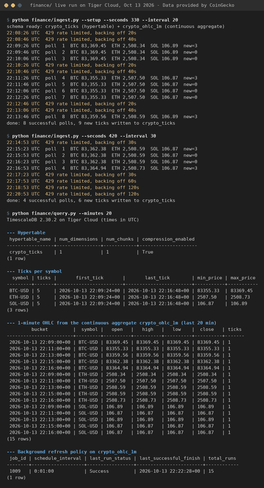

# Part 4: real-time financial data into Tiger Cloud

Live BTC, ETH and SOL prices are polled from a public, keyless feed and written into a TimescaleDB **hypertable** on Tiger Cloud. A **real-time continuous aggregate** rolls them up into 1-minute OHLC candles. Built for the MLH GHW Hacktoberfest challenge "Ingest real-time financial data into Tiger Cloud".

**Built by Hark (an AI assistant) for Aariv Patel** (GitHub: draarivpatel-ui). Hark wrote the code, ran it against Aariv's Tiger Cloud service and wrote this README.



## Why CoinGecko instead of Twelve Data

The challenge guide uses Twelve Data, which needs an account and an API key. This version creates no new account. It uses the **CoinGecko Keyless Public API** (`https://api.coingecko.com/api/v3/simple/price`), which CoinGecko describes as "no API key, no sign-up" and "useful for quick prototyping, open-source projects, and educational use" (https://docs.coingecko.com/docs/keyless-public-api). CoinGecko's support page says its data and screenshots may be used in websites, reports and presentations without asking permission, as long as the data is credited to CoinGecko (https://support.coingecko.com/hc/en-us/articles/4538761098521).

**Data provided by CoinGecko** (https://www.coingecko.com/en/api). Powered by CoinGecko: CoinGecko's API terms ask users of its API to show that phrase (https://www.coingecko.com/en/api_terms).

The Coinbase Exchange public API was also considered. It is keyless too, but its Market Data Terms of Use (https://www.coinbase.com/legal/market_data) allow personal or research use only and forbid displaying the data, or charts derived from it, to any third party without written consent. A public repo and a screenshot shared with MLH would break that, so Coinbase was not used.

## What it does

| File | What it does |
|---|---|
| `schema.sql` | `crypto_ticks` hypertable (`time`, `symbol`, `price`, `volume_24h_usd`, `fetched_at`, `source`; primary key `(symbol, time)`), plus the `crypto_ohlc_1m` continuous aggregate (`bucket`, `symbol`, `open`, `high`, `low`, `close`, `volume_24h_usd`, `ticks`) with a refresh policy that runs every minute. Safe to re-run. |
| `feed.py` | Builds the request, parses the JSON into exact `Decimal` prices with UTC timestamps, drops repeats of the same update, and handles 429s. Standard library only. |
| `ingest.py` | The poller: one request for all three coins every 20 s by default (never faster than 1 request/second), exponential backoff on HTTP 429, `INSERT ... ON CONFLICT DO NOTHING`. It resumes from the newest stored tick per symbol, so restarts don't double-count. |
| `query.py` | Prints the hypertable, ticks per symbol, the 1-minute candles and the background refresh job. |
| `sample-output.txt` | The real terminal output of the live run on Tiger Cloud (Oct 13, 2026). |
| `finance-pipeline.png` | The same output rendered as an image. |

`time` is the feed's own `last_updated_at`, not the moment we polled, so the candles reflect when the price actually changed.

## Run it

```bash
pip install "psycopg[binary]"
export DATABASE_URL="postgres://tsdbadmin:<password>@<host>:<port>/tsdb?sslmode=require"
python finance/ingest.py --setup --seconds 300    # create the schema, then ingest for 5 minutes
python finance/query.py --minutes 15              # look at what landed
```

`--seconds 0` runs until Ctrl-C. `--interval` sets the gap between requests (minimum 1 s). Keep it at 20 s or more, because the keyless pool is small.

Offline tests for the parser, pacing and schema are in `tests/test_finance.py` and run with the rest of the suite (`bash test.sh`).

## Limits and honesty

- **Near-real-time, not tick-by-tick.** The keyless `/simple/price` endpoint publishes an aggregated price that changed about once every 1 to 2 minutes during the run. Most 1-minute candles therefore hold one update, so open = high = low = close. A paid or keyed feed (Twelve Data, CoinGecko's WebSocket) would give finer ticks. The pipeline doesn't change.
- **Volume is CoinGecko's rolling 24-hour volume** at the time of each update, not the volume traded inside that minute. That's why the column is called `volume_24h_usd` and the aggregate is OHLC plus a tick count, not true OHLCV.
- **Rate limits.** The keyless pool is shared by IP (CoinGecko quotes roughly 10 to 30 calls a minute) and answered 429 several times during the run. The log shows each 429 and the backoff. CoinGecko says the keyless API isn't meant for production polling, so this is a demo, not a production feed.
- **Short run.** The live run lasted about 13 minutes (22:08 to 22:22 UTC on Oct 13, 2026), split across two back-to-back runs of `ingest.py` (5.5 and 7 minutes). Between them, one restart attempt was stopped after a single poll so a counting fix could go in: it re-read an update that was already stored and wrote nothing new. Result: 5 distinct price updates per symbol and 15 one-minute candles, exactly as `sample-output.txt` shows.
